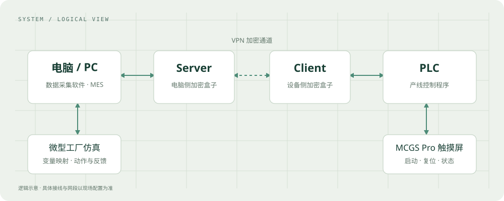
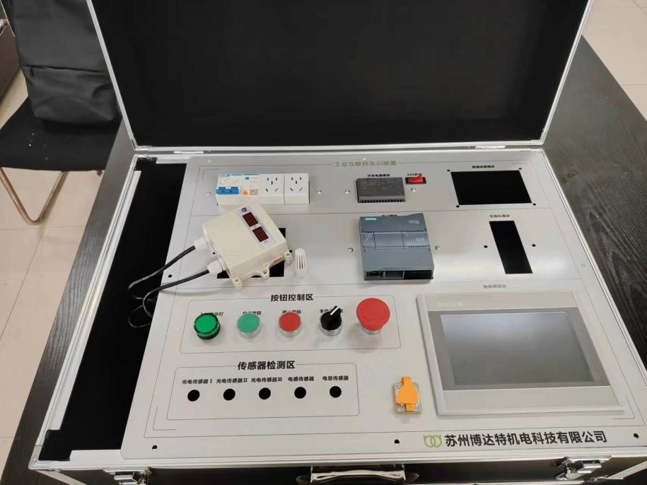

# 第二次参加 ISCC：微型工厂的 PLC 控制与加密实践

这是我第二次参加全国大学生信息安全与对抗技术竞赛（ISCC）。这次参与的任务是微型工厂模拟产线：主办方提供工厂仿真页面，我们需要根据各个工位和元件，在博图（TIA Portal）里编写 PLC 程序，再通过数据采集软件，把 PLC 变量与仿真元件对应起来。最终，通过触摸屏上的启动按钮，让产线自动完成物料流转并送入对应货架。

我主要负责程序编写，以及安全任务二和任务四，也协助队友完成其他部分。因此，这篇复盘会重点介绍产线控制、MES 文本加解密页面，以及加密盒子与人脸识别的接入；加密狗和网络对抗部分则作为团队方案一起说明。

除了自动控制，这次比赛还包含信息安全任务：加密狗校验、页面内容加密、异常探测与通信保护，以及人脸识别准入。它们分别涉及程序运行许可、数据内容、通信链路和操作人员身份。

这篇文章记录我使用的技术方案，也说明各个模块解决的问题和目前能够确认的边界。

## 先把系统之间的关系理清

这套系统包含几个相互配合的部分：博图用于编写 PLC 控制程序；仿真平台提供工位、传感器和执行元件；数据采集软件负责把 PLC 中的变量与仿真对象连接起来；MCGS Pro 用于制作触摸屏操作界面。电脑与 PLC 之间的通信链路接入加密盒子。



<p class="figure-note">按本次项目描述和加密盒子参考拓扑整理的逻辑示意，省略具体网段与端口。</p>

| 部分 | 主要职责 | 需要关注的连接点 |
| --- | --- | --- |
| PLC 与博图 | 运行产线控制逻辑 | 输入、输出、流程状态与运行许可 |
| 仿真平台与采集软件 | 将变量变化映射为场景中的动作与反馈 | 变量地址、类型、读写方向与刷新 |
| MCGS Pro 触摸屏 | 提供启动、复位和警示等交互 | 按钮命令、状态反馈与告警显示 |
| 加密狗 | 参与运行许可校验 | 心跳、KEY 与校验结果 |
| Server / Client 加密盒子 | 在电脑侧和 PLC 侧之间建立受保护通道 | 接口、网段、隧道与准入状态 |

这些连接点共同决定系统能否正常运行。例如，一个启动命令需要从界面进入控制程序，程序产生的输出需要映射到仿真元件，元件的反馈再回到 PLC，供后续逻辑判断。

## 从工位动作到 PLC 控制流程

赛题给出的基本动作包括复位、出料、供料、检测和放置。我的工作是根据现场提供的工位和元件编写控制程序，并让这些动作组成连续流程。

复位让设备回到初始位置；出料装置把物料推到检测位置；机械臂通过吸盘取料，将物料送到检测单元；之后再把物料放入货架。用户看到的是启动后的一串动作，程序需要处理的是每个动作的命令与反馈关系。

```text
复位 → 出料 → 取料与供料 → 检测 → 搬运并放入货架
```

上面是便于理解的业务流程，不代表最终程序中的块名、步号或梯形图结构。

对这类顺序控制，值得重点检查的是动作的完成条件：推缸是否到位、物料是否已经出现、取料是否完成，以及设备是否满足下一步动作的条件。只发送动作命令，不能代替对完成反馈的判断。

同样，复位需要考虑流程状态。机械位置回到起点后，控制程序里残留的运行标志、完成状态和待执行命令，也需要与新的起始状态保持一致。这是阅读和复查最终 PLC 程序时应当一起核对的部分。

## 变量采集让程序与仿真场景连起来

PLC 程序写好之后，我通过数据采集软件，把博图中的变量与仿真平台各个元件连接起来。控制链路可以概括为：

```text
PLC 输出变量 → 采集与映射 → 仿真执行元件
PLC 输入变量 ← 采集与映射 ← 仿真传感器反馈
```

这里既有控制命令，也有状态回传。前者让元件动作，后者让 PLC 知道场景中发生了什么。两条方向配合，程序才能继续推进流程。

映射时需要核对地址、数据类型和读写方向。界面上一个名称相近的变量，不一定就是当前动作所需的点位；数值发生变化，也不一定代表变化的方向正确。刷新和通信状态同样影响动作反馈能否及时送回程序。

如果后续整理项目资料，我会把这部分补成正式的变量映射表，逐项记录 PLC 地址、仿真对象、用途和方向。它能帮助读者理解程序，也方便以后排查场景与程序不同步的问题。

## 用 MCGS Pro 提供操作入口

我们使用 MCGS Pro，为 PLC 触摸屏配置启动按钮、复位按钮、警示灯等控件，通过界面控制整体流程。

界面的职责是把操作命令传给 PLC，并把实际状态展示出来。例如，启动按钮对应启动请求，复位按钮对应复位请求，警示灯对应需要提示的异常。界面显示的状态应当来自控制侧反馈，才能帮助操作人员判断产线当前处于什么状态。



<p class="figure-note">图片来自赛题文档，用于说明平台构成，并非本次作品的现场截图。</p>

## 加密任务一：心跳检测与 KEY 校验

第一项安全任务要求 PLC 与加密狗进行实时校验。规则说明，由 MES 向 PLC 写入加密狗 KEY 码与 KEY 码校验码；加密狗拔出、缺失或不匹配时，受保护逻辑应停止，并给出明确告警。

这部分由队友主导，我协助完成，方案包含心跳检测和 KEY 值校验。这两部分关注不同的问题：心跳用于判断校验链路是否仍在持续工作，KEY 校验用于判断当前凭据是否符合要求。

仅仅在启动时读取一次正确的 KEY，无法反映加密狗后来被拔出的情况；只看到某个心跳值存在，也不能说明它仍在刷新。因此，运行许可需要结合凭据校验结果和心跳的持续更新情况来判断。

```text
心跳保持更新 + KEY 校验通过 → 满足受保护逻辑的许可条件
心跳超时或 KEY 校验失败   → 撤销许可，并进入停止与告警处理
```

这是方案层面的逻辑表达。具体的心跳变量、超时时间、KEY 校验公式以及许可失效后的输出处理，需要结合最终博图程序中的实现继续展开。

## 加密任务二：在 MES 中加入文本加解密页面

第二项任务中，我在数据采集软件的 MES 页面里加入了加解密功能，对应文件是 `DeCode.aspx`。这个页面接收文本和口令，使用浏览器的 Web Crypto API 在本地完成处理。

### 从口令派生密钥，再加密文本

页面使用 PBKDF2-HMAC-SHA-256 从口令派生 AES 密钥。代码中的迭代次数是 600,000 次，每次加密随机生成 16 字节盐值，再使用 AES-256-GCM 加密文本。GCM 的 nonce 为 12 字节，认证标签为 128 位。

下面是页面中的密钥派生逻辑：

```javascript
async function deriveKey(password, salt) {
    var material = await window.crypto.subtle.importKey(
        "raw", utf8Encoder.encode(password), "PBKDF2", false, ["deriveKey"]
    );
    return window.crypto.subtle.deriveKey(
        { name: "PBKDF2", salt: salt, iterations: ITERATIONS, hash: "SHA-256" },
        material,
        { name: "AES-GCM", length: 256 },
        false,
        ["encrypt", "decrypt"]
    );
}
```

随机盐值与 nonce 使相同文本、相同口令在多次加密时产生不同结果。认证标签用于在解密时校验数据；口令错误或密文被修改时，认证通常无法通过。

### 密文格式与页面交互

输出格式为：

```text
MESENC1.600000.<Base64URL 编码的数据>

编码的数据 = 16 字节盐值 || 12 字节 nonce || 密文与认证标签
```

格式前缀和迭代次数同时参与附加认证数据（AAD）。解密代码校验前缀、迭代次数和数据长度，使用相同口令派生密钥，然后尝试解密并校验 UTF-8 文本。

这里的 Base64URL 用于把二进制结果表示成便于复制的文本，保密性来自 AES-GCM。盐值与 nonce 随密文保存，口令不包含在这个输出包里。

交互上，页面提供加密、解密、清空、显示或隐藏口令，以及复制结果。加密入口要求口令至少 12 个字符，单次明文上限为 1 MiB。处理过程中按钮会暂时禁用，结束后清空口令输入框。清空输入框不等于能够证明浏览器内存已经被安全擦除。

### 文本加密与链路加密分别解决什么

这个页面能确认实现的是文本内容加解密。指定文本经用户输入并加密后，可以作为密文保存；主动解密后，明文仍需要在页面上显示。

因此，这份代码不能单独证明整个 MES 页面、HTTP 通信或 PLC 报文都已加密，也不能保证解密后的明文无法被当前浏览器的调试工具读取。Web Crypto 通常还需要 HTTPS 或 localhost 等安全上下文，直接通过普通局域网 HTTP 地址访问时应检查浏览器支持情况。

此外，评分表提到了国密算法，而当前页面使用 AES-GCM。页面采用的算法、链路使用的算法以及赛题的具体判分要求，需要分别核对。

## 加密任务三：探测与数据注入对抗

第三项任务涉及异常检测和通信保护，也是我协助队友完成的部分。我们使用的工具包括 Nmap / Zenmap，以及 PLC 信号修改工具。结合赛题，它们分别用于观察比赛网络中的主机与服务暴露情况，以及尝试修改 PLC 数据，检验防护是否有效。

这项任务需要同时观察业务侧的变化：在出现探测行为时，通信是否受到影响；出现未经预期的数据写入时，PLC 中的值是否变化；防护动作发生后，正常采集和控制是否仍然可用。单独一张工具运行截图，无法说明整个防护过程。

加密盒子参考文档提到了 `guard.sh` 等异常检测相关脚本，以及连接脚本的配置。但文档没有提供足够的实现细节来证明其检测规则、阈值和数据注入识别能力。

这里还有一个需要区分的场景：主动扫描通常会产生可观察的通信行为；纯被动抓包可能不向被监听设备发包，不能仅靠高频流量阈值保证发现。链路加密则可以减少流量被截获后直接暴露业务明文的风险。

## 加密任务四：人脸识别与通信准入

参考文档给出的拓扑由电脑、Server 加密盒子、Client 加密盒子和设备端组成。电脑连接 Server 侧以太网口，Client 侧连接设备，两盒之间可以通过网线或 Wi-Fi 连接，并配置 VPN 加密隧道。本次项目的设备端是 PLC。

配置时，需要分别理解电脑侧业务网段、PLC 侧业务网段，以及两盒之间的连接网段。参考文档使用 `swanctl` 配置中的地址和流量选择器来指定通道两端及受保护的业务网段。端口能连通、地址配置正确和业务流量进入隧道，是需要逐层核对的事情。

人脸模块通过注册和识别按键完成操作。参考文档描述，系统可能在启动阶段等待人脸认证，通过后再继续进入后续流程；自启动配置涉及人脸识别、连接和异常检测脚本。

这说明人脸认证被纳入了启动与接入流程。赛题进一步要求活体检测、照片无法通过，以及识别失败时 PLC 无有效通信。但仅凭这份使用说明，不能确认模块的活体检测效果，也不能确认生物特征令牌参与每一帧密钥计算。对这些能力的描述，需要有现场验证记录或更完整的实现资料支撑。

## 后续复查与整理

这次项目把自动控制和通信安全放在同一个系统里。正常情况下，按钮命令、PLC 逻辑、变量采集和仿真反馈需要配合；许可或通信出现异常时，也需要明确哪些动作应停止、哪些状态应提示，以及满足什么条件后可以重新启动。

从资料整理的角度，我接下来最想补齐三部分：实际工位与变量映射、关键控制和校验逻辑，以及现场运行和对抗记录。它们能让这篇复盘从系统说明进一步变成可核对的实现记录。

本文暂未列出比赛成绩、完整 PLC 程序细节和现场攻防结论。后续补上博图导出的程序块、触摸屏与仿真运行截图后，可以继续展开具体实现。

## 资料说明

本文结合个人项目流程、赛题《智能安全赛—微型工厂模拟产线任务挑战》、加密盒子参考文档及 `DeCode.aspx` 源码整理。博图项目入口文件标识的兼容版本为 V16；其内部控制逻辑仍需通过博图打开完整项目，或导出程序块后核对。

文中系统图为重新绘制的逻辑示意；实训装置照片来自赛题文档。原始文档与工程文件未附在博客中。
